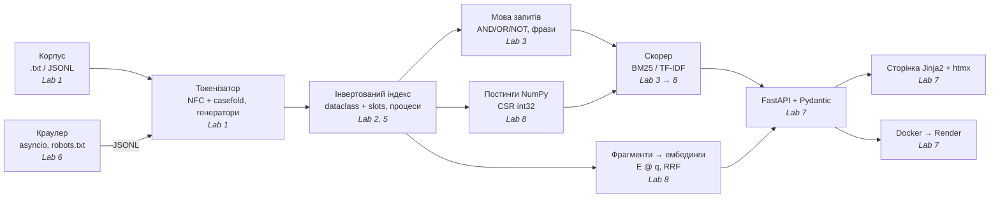

# findex

**Повнотекстовий і семантичний пошук по всіх 744 Python Enhancement Proposals, написаний з нуля — від токенізатора до веб-сервісу — за 8 лабораторних курсу Python.**

**Жива версія:** _адреса з'явиться після деплою на Render — див. [Деплой](#деплой)_ · API: `/docs` · **Відео (2–3 хв):** _посилання додати після запису_

[](https://github.com/dfsgotl-lenya/findex/actions/workflows/ci.yml)
[](https://sonarcloud.io/summary/new_code?id=dfsgotl-lenya_findex)


| Корпус | p95 під навантаженням | Найбільше прискорення |
|---|---|---|
| **744 PEP**, 13 МБ тексту, 31 753 терми, 481 435 постингів, 11 402 фрагменти з ембедингами | **351 мс** при 50 одночасних клієнтах, 1 процес, 190 запитів/с (у v0.7.0 було 1 526 мс і 44 запити/с) | **24.5×** — BM25 на NumPy проти Python-циклу (OR-запит, корпус ×10) |

## Що вміє

- **Пошук за словами:** Boolean-мова (`AND`, `OR`, `NOT`, дужки, `"фрази"`), ранжування BM25 або TF-IDF, сніпети з підсвіткою.
- **Пошук за змістом:** запит і фрагменти документів перетворюються на вектори (WordLlama), близькість — косинусна. Запит «run python threads truly in parallel» знаходить PEP 703 про GIL, хоча слів «GIL» чи «lock» у ньому немає.
- **Гібрид:** обидва рейтинги зливаються через Reciprocal Rank Fusion.
- **Веб:** HTTP API з OpenAPI-документацією, сторінка з пошуком під час набору (htmx), перегляд документа.
- **Інфраструктура:** CLI `findex`, асинхронний краулер, паралельна індексація, Docker-образ, CI з типами, тестами (167 тестів, покриття 79 %) і бенчмарками.

## Як це влаштовано



Шлях запиту: uvicorn → middleware (request id, лог) → валідація параметрів Pydantic → `Depends(get_index)` → парсер запиту → Boolean-фільтр (кешований) → NumPy-скорер або `E @ q` → top-k через `np.argpartition` → сніпети → Pydantic-відповідь або HTML.

## Швидкий старт

```bash
uv sync
# корпус PEP лежить у репозиторії (4 МБ, gzip)
uv run python -c "import gzip,shutil,pathlib; pathlib.Path('data').mkdir(exist_ok=True); shutil.copyfileobj(gzip.open('corpus/peps.jsonl.gz'), open('data/peps.jsonl','wb'))"
uv run findex index data/peps.jsonl --out data/peps.bin --positions --workers 4   # ~6 с
uv run findex embed data/peps.bin                                                # ~20 с, без мережі
uv run findex search data/peps.bin "global interpreter lock" -k 5
uv run findex search data/peps.bin "run python threads truly in parallel" --mode hybrid
uv run findex serve --index data/peps.bin        # http://127.0.0.1:8000
```

Або в Docker (індекс і ембединги будуються під час збірки):

```bash
docker build -t findex . && docker run --rm -p 8000:8000 findex
```

## API

| Маршрут | Що повертає |
|---|---|
| `GET /search?q=&k=&page=&scorer=bm25\|tfidf&mode=keyword\|semantic\|hybrid` | сторінка результатів: `total`, `pages`, `took_ms`, `results[{doc_id, title, score, snippet, url}]`; 422 на невалідні параметри або запит, 503, якщо ембединги не завантажені |
| `GET /docs/{doc_id}` | повний текст документа; 404, якщо такого немає |
| `GET /stats` | розмір індексу, словник, постинги, кількість фрагментів, uptime |
| `GET /health` | 200 `{"status": "ok"}`; 503, поки індекс вантажиться або якщо не завантажився |
| `GET /docs` | інтерактивна OpenAPI-документація |

Конфігурація — лише змінні оточення: `INDEX_PATH`, `SEMANTIC_PATH`, `LOG_LEVEL`, `LOG_FORMAT=text|json`, `PORT`, `WEB_CONCURRENCY` (див. `.env.example`).

## Деплой

`render.yaml` описує сервіс для Render: **New → Blueprint →** цей репозиторій. Render збирає `Dockerfile`, перевіряє `/health`, логи (JSON з `request_id`) видно в панелі **Logs**. Безкоштовний екземпляр має 512 МБ — процесу потрібно ~310 МіБ, тому один воркер. Після першого деплою вписати адресу в перший рядок цього README і заповнити рядок «розгорнутий» у таблиці навантаження (`oha -z 30s -c 20 "https://<адреса>/search?q=python+type+annotations&k=10"`).

## Виміри: Lab 1–8 в одному місці

Корпус Lab 1–5 — синтетичний (300 документів з `benchmarks/make_demo_corpus.py`), Lab 6 — локальне дзеркало, Lab 7–8 — 744 PEP. Повні звіти з поясненнями — у [`docs/LABS.md`](docs/LABS.md).

### Lab 1 — потокова обробка

Окремі числа lazy/eager і `tracemalloc` у вихідному звіті Lab 1 не збереглися, тому тут їх немає.

### Lab 2 — індекс, серіалізація, пам'ять (синтетичний корпус)

| Терм | Група | Двигун | Результатів | Середній час (мс) |
|---|---|---|---:|---:|
| токен | common | merge | 300 | 0.0048 |
| токен | common | set | 300 | 0.0048 |
| raretoken0001 | rare | merge | 1 | 0.0010 |
| raretoken0001 | rare | set | 1 | 0.0010 |

| Формат | Розмір (MiB) | Save (с) | Load (с) |
|---|---:|---:|---:|
| pickle | 0.26 | 0.020832 | 0.018150 |
| JSON | 0.41 | 0.033599 | 0.013174 |

| Варіант | Пікова пам'ять (MiB) | Розмір pickle (MiB) | Load (с) |
|---|---:|---:|---:|
| plain | 2.39 | 0.31 | 0.006774 |
| slots | 1.72 | 0.24 | 0.015783 |
| array | 0.90 | 0.15 | 0.000246 |

### Lab 3 — Precision@5 (синтетичний корпус)

| Запит | TF-IDF P@5 | BM25 P@5 |
|---|---:|---:|
| python, search, generators, tokenizes, unicode | 1.00 | 1.00 |
| raretoken0001 … raretoken0005 (1 релевантний документ) | 0.20 | 0.20 |

### Lab 4 — якість коду

`findex 0.4.0`: Ruff, Ruff format, Pyright strict і pytest у CI; покриття тоді 58 %, у v1.0.0 — **79 %**, 167 тестів.

### Lab 5 — паралельна індексація (300 документів)

| Executor | Workers | Wall (s) | Speedup |
|---|---:|---:|---:|
| serial | 1 | 0.9874 | 1.00× |
| threads | 4 | 0.9940 | 0.99× |
| threads | 20 | 0.9183 | 1.08× |
| processes | 2 | 0.8585 | 1.15× |
| processes | 4 | 0.6720 | 1.47× |
| processes | 20 | 0.9874 | 1.00× |

| GIL-експеримент | CPython 3.13 | 3.13t (free-threaded) |
|---|---:|---:|
| один CPU-bound виклик | 0.4273 s | 0.4599 s |
| два послідовно | 0.8637 s | 0.9424 s |
| два потоки | 0.8886 s | 0.4603 s |
| два процеси | 0.5312 s | 0.5632 s |

### Lab 6 — асинхронний краулер (200 сторінок, локальне дзеркало)

| Concurrency | Wall (s, median) | Pages/s |
|---:|---:|---:|
| 1 | 4.218 | 47.42 |
| 5 | 2.182 | 91.67 |
| 20 | 2.078 | 96.25 |

### Lab 7 — веб-сервіс (v0.7.0, 2 vCPU)

20 одночасних `/search`, 1 воркер — чи блокується цикл подій:

| Маршрут | Усі 20 (мс) | `/health` max під навантаженням (мс) | Відповідей `/health` за серію |
|---|---:|---:|---:|
| `def` (пул потоків) | 472 | 141 | 9 |
| `async def` (на циклі) | 372 | 348 | 4 |

`oha -z 30s -c 50 "/search?q=python+type+annotations&k=10"`:

| Ціль | RPS | p50 (мс) | p95 (мс) | p99 (мс) |
|---|---:|---:|---:|---:|
| v0.7.0, 1 воркер, `async def` | 55.3 | 885 | 1 083 | 1 947 |
| v0.7.0, 1 воркер, `def` | 43.5 | 1 144 | 1 526 | 2 269 |
| v0.7.0, 4 воркери | 98.0 | 300 | 1 327 | 1 698 |
| розгорнутий (Render free, `-c 20`) | _після деплою_ | | | |

### Lab 8 — після профілювання і NumPy (v1.0.0, той самий запит і машина)

| Ціль | RPS | p50 (мс) | p95 (мс) | p99 (мс) |
|---|---:|---:|---:|---:|
| 1 воркер, keyword | 189.9 | 261 | 351 | 403 |
| 1 воркер, semantic | 166.5 | 297 | 381 | 530 |
| 1 воркер, hybrid | 153.8 | 319 | 436 | 527 |
| 4 воркери, keyword | 450.5 | 48 | 321 | 373 |

Скорер на NumPy (лише ранжування, BM25, k=10; таблиці з TF-IDF — [`docs/lab08_numpy_scorer.md`](docs/lab08_numpy_scorer.md)):

| Запит | Документів | Lab 3 (мс) | NumPy (мс) | Прискорення | Корпус ×10: Lab 3 / NumPy (мс) | Прискорення ×10 |
|---|---:|---:|---:|---:|---:|---:|
| частий терм `python` | 729 | 0.645 | 0.070 | 9.2× | 5.786 / 0.327 | 17.7× |
| середній терм `generator` | 100 | 0.100 | 0.036 | 2.8× | 0.853 / 0.077 | 11.0× |
| рідкісний терм (df=3) | 3 | 0.005 | 0.022 | **0.3×** | 0.039 / 0.033 | 1.2× |
| 3 терми, AND | 68 | 0.242 | 0.079 | 3.1× | 2.070 / 0.242 | 8.6× |
| 3 терми, OR | 744 | 1.214 | 0.111 | 10.9× | 11.926 / 0.486 | **24.5×** |

Precision@5 на 15 запитах — [нижче](#3-семантичний-і-гібридний-пошук).

## Lab 8: швидше, потім розумніше

### 1. Профіль до змін

Повний звіт: [`docs/lab08_profiling.md`](docs/lab08_profiling.md), flame graphs: [`search`](docs/lab08_flame_search.svg), [`index`](docs/lab08_flame_index.svg). Три найдорожчі місця записані **до** правок (окремий коміт):

| # | Місце | Python чи native | Гіпотеза | Результат |
|---|---|---|---|---|
| 1 | `pickle.load` 482 тис. `Posting` — 2.55 с з 2.85 с `findex search` | Scalene: native (виклик C-функції); cProfile: всередині — Python-`_dataclass_setstate` → `fields()` на кожен об'єкт | власний `__reduce__`; масиви NumPy | load 1.96 → 1.22 с; `.npz` без позицій — **0.03 с** |
| 2 | сніпети: на кожен результат заново читається JSONL, `json.loads`, `casefold` — 72 % пошуку в процесі | native (json, casefold, I/O) | кеш тексту | 2.67 → 1.07 мс на пошук |
| 3 | скоринг: виклик `BM25.__call__` на кожен постинг | Python | вирази над масивами `int32` | 9–25× на довгих списках, 0.3× на коротких |

Повторний профіль веб-шляху знайшов четверте місце: пошук вікна для сніпета ковзав по **всіх** входженнях терма в Python і забирав ~21 мс на запит. Заміна на `str.find` по заздалегідь опущеному в нижній регістр тексту і перевірку інших термів лише в околі найрідкіснішого дала 3.6 мс; разом з NumPy це підняло keyword-режим під навантаженням із 57 до 190 запитів/с.

### 2. NumPy-скорер

`src/findex/arrays.py`: постинги всіх термів у двох плоских масивах `int32` (`doc_ids`, `tfs`) з `offsets` (формат CSR), `doc_len` — один `int32[N]`. BM25 для одного терма — кілька операцій над цілими масивами (`tf + k1·(1 − b + b·dl/avgdl)`, де `dl = doc_len[doc_ids]` через fancy indexing), top-k — `np.argpartition` за O(n) замість сортування. Порядок операцій такий самий, як у Lab 3, а логарифми беруться через `math.log` (не `np.log`), тому **бали збігаються біт-у-біт**: `tests/test_arrays.py` перевіряє і порядок, і самі числа на 8 запитах × 3 скорери × 4 значення k.

**Чому прискорення різне.** На частому термі (729 постингів) Python робить 729 викликів методу з атрибутами й діленнями, а NumPy — кілька проходів у C по суцільній пам'яті: 9×. На корпусі ×10 списки вдесятеро довші, а фіксовані витрати NumPy ті самі — 18–25×. На рідкісному термі (3 постинги) NumPy **повільніший** (0.3×): створення масивів, маски й `argpartition` коштують ~20 мкс незалежно від розміру, а Python-цикл на 3 елементи — 5 мкс. Векторизація окупається, коли накладні витрати виклику розподіляються на багато елементів.

`pytest-benchmark` для `search` і `build_index` іде в CI окремим кроком: таблиця потрапляє в summary кожного запуску, JSON — в артефакти; окремий тест падає, якщо NumPy-шлях перестане бути щонайменше вдвічі швидшим за Python-цикл.

### 3. Семантичний і гібридний пошук

- `findex embed` ділить кожен документ на фрагменти до 200 слів (абзаци пакуються разом, довгі ріжуться по словах), додає до фрагмента заголовок PEP і рахує ембединги. Матриця `E: float32[11 402, 256]` (11.1 МіБ) і карта `фрагмент → (doc, start, end)` зберігаються як `.npy`.
- **Модель — WordLlama `l2_supercat`** (256 вимірів). Ваги (16 МБ) входять у сам wheel з PyPI, тож ембединги рахуються без мережі — у Docker-збірці, в CI і на безкоштовному Render (512 МБ). Це статична модель (ембединги токенів Llama 2 + усереднення): слабша за трансформер all-MiniLM-L6-v2, але в рази дешевша. MiniLM теж підтримується: `findex embed --model all-MiniLM-L6-v2` після `uv pip install sentence-transformers`.
- `mode=semantic`: `sims = E @ q` — одне множення матриці на вектор дає косинус до всіх фрагментів (вектори нормалізовані, тож косинус дорівнює скалярному добутку); документ отримує бал свого найкращого фрагмента (`np.lexsort` за `(doc, −sim)` і перший фрагмент кожної групи).
- `mode=hybrid`: `RRF(d) = Σ 1/(60 + rank_d)` по списку BM25 і семантичному списку (по 100 документів). Звичайний запит у гібриді шукає ключові слова через `OR`, бо інакше один відсутній терм обнулив би половину гібрида.
- Режим є в CLI (`--mode`), в API (`mode=`) і на сторінці (перемикач «Words / Meaning / Both»).

**Precision@5.** Запити Lab 3 були на синтетичному корпусі, де релевантні всі документи, тож для PEP складено 10 нових розмічених запитів і 5 перефразованих, де навмисно немає ключових слів теми. Мітки зафіксовано до запуску: для тематичних запитів релевантні всі PEP з відповідним полем `Topic:` (воно зберігається окремо від тексту і не індексується), для решти — явні списки номерів PEP у `benchmarks/evaluate_lab8.py`.

| # | Запит | Тип | Релевантних | Keyword | Semantic | Hybrid |
|---:|---|---|---:|---:|---:|---:|
| 1 | type hints | ключові слова | 49 | 1.00 | 1.00 | 1.00 |
| 2 | packaging metadata | ключові слова | 103 | 1.00 | 1.00 | 1.00 |
| 3 | release schedule | ключові слова | 27 | 1.00 | 1.00 | 1.00 |
| 4 | steering council | ключові слова | 26 | 1.00 | 1.00 | 1.00 |
| 5 | structural pattern matching | ключові слова | 6 | 1.00 | 1.00 | 1.00 |
| 6 | global interpreter lock | ключові слова | 5 | 0.40 | 0.80 | 0.40 |
| 7 | async await coroutines | ключові слова | 6 | 0.60 | 0.60 | 0.60 |
| 8 | assignment expressions | ключові слова | 3 | 0.40 | 0.60 | 0.40 |
| 9 | string interpolation | ключові слова | 10 | 0.80 | 1.00 | 1.00 |
| 10 | data classes | ключові слова | 2 | 0.20 | 0.40 | 0.40 |
| 11 | describe which kinds of values a variable may hold | перефраз | 49 | 0.00 | 0.60 | 0.40 |
| 12 | bundle a library so people can install it | перефраз | 103 | 0.60 | 0.60 | 0.60 |
| 13 | branch on the shape of nested data and pull out parts | перефраз | 6 | 0.00 | 0.00 | 0.20 |
| 14 | run python threads truly in parallel on several cores | перефраз | 5 | 0.00 | 0.40 | 0.20 |
| 15 | who has the final say over changes to the language | перефраз | 26 | 0.40 | 0.00 | 0.40 |
| | **середнє, 10 запитів ключовими словами** | | | **0.74** | **0.84** | **0.78** |
| | **середнє, 5 перефразів** | | | **0.20** | **0.32** | **0.36** |
| | **середнє, усі 15** | | | **0.56** | **0.67** | **0.64** |

**Що видно з таблиці.** На запитах, де слова збігаються зі словником документів (1–5), усі три режими ідеальні: тут BM25 уже робить усе. На перефразах ключові слова майже безсилі — три з п'яти дають 0, бо в релевантних PEP немає слів на кшталт «kinds of values» чи «shape of nested data», а неявний `AND` вимагає всіх. Пошук за змістом піднімає перефрази з 0.20 до 0.32 і знаходить документи про типізацію та GIL без жодного спільного ключового слова. Але він не всесильний: запит 15 («who has the final say…») семантичний режим провалив повністю — модель зачепилась за окремі слова і підняла PEP про `final` і мораторій на зміни мови, — а ключові слова знайшли PEP про моделі керування. Гібрид не найкращий у жодному рядку окремо, зате не падає до нуля, коли хоча б один зі списків правий, і має найкраще середнє на перефразах (0.36). Обережно з висновками: 15 запитів і P@5 — грубий інструмент, різниця 0.20 — це один документ у топ-5. Слабке місце — сама модель: статичні ембединги усереднюють слова без порядку і контексту, тож трансформер (MiniLM) на перефразах мав би бути помітно кращим; це перше, що варто перевірити далі.

### Відтворити

```bash
uv run python benchmarks/benchmark_numpy_scorer.py data/peps.bin [--replicate 10]
uv run python benchmarks/benchmark_search_path.py data/peps.bin
uv run python benchmarks/evaluate_lab8.py data/peps.bin data/peps.jsonl
uv run pytest tests/test_benchmarks.py --benchmark-enable --benchmark-only
bash benchmarks/load_test.sh data/peps.bin 30s 50        # потрібен oha
```

## Обмеження

- **Корпус маленький.** 744 документи, усе в пам'яті. На 50 млн фрагментів першим зламається брутфорс `E @ q` (≈ 51 ГБ матриця) і pickle-індекс з позиціями; потрібні ANN-індекс (HNSW: FAISS або hnswlib) та індекс на диску (`np.memmap`, стиснені постинги).
- **Модель ембедингів слабка.** WordLlama — статичні вектори слів без контексту; на перефразах P@5 лише 0.32. MiniLM підтримується, але на цьому корпусі не виміряний.
- **Пошук за словами без стемінгу і стоп-слів:** `thread` не знаходить `threads`, а запит з `in` чи `the` фільтрує й за ними. Звичайний запит — неявний `AND`; слова `and`/`or`/`not` у будь-якому регістрі — оператори.
- **Pickle-індекс** вантажиться ~1.2 с і небезпечний з недовірених джерел. `.npz` (0.03 с) поки не містить позицій для фраз, тому основним форматом лишається pickle.
- **Один процес — один GIL:** один воркер упирається в ~190 запитів/с на цьому запиті; кожен додатковий воркер — ще одна копія індексу (~310 МіБ).
- **Безкоштовний Render** засинає після 15 хв простою; перший запит після цього — 30–60 с.
- Немає автентифікації, rate limiting і HTTP-кешування.

## Reflection — Lab 8

1. **cProfile vs py-spy vs Scalene.** cProfile — детерміністичний: рахує кожен виклик Python-функції (точні `ncalls`), але сповільнює програму і не бачить рядків. py-spy — семплює стек ззовні процесу майже без накладних витрат, тому саме його підключають до живого продакшн-процесу (`py-spy dump/top --pid`). Scalene — семплює з розділенням часу на Python / native / system і пам'ять по рядках — показує, чи взагалі допоможе векторизація.
2. **`a + b` для float.** CPython: опкод `BINARY_OP`, перевірка типів, пошук `float.__add__`, розпакування двох `PyFloat`, додавання, виділення нового об'єкта, лічильники посилань. NumPy для `A + B`: один виклик ufunc, C-цикл по суцільних буферах (з SIMD), без об'єкта на елемент. Звідти й 100×.
3. **Broadcasting `(N, 1)` і `(1, M)`** дає `(N, M)`: розмірність 1 «розтягується» без копіювання входів, але результат — справжній масив N·M елементів (для float64 — 8·N·M байт).
4. **`argpartition` vs `argsort` для top-k:** O(n) проти O(n log n); сортувати потрібно лише k відібраних.
5. **40× на частому, 1.5× на рідкісному:** фіксовані витрати NumPy (~20 мкс) розподіляються на тисячі постингів у першому випадку і на кілька — у другому (у нас на df=3 узагалі 0.3×).
6. **Ембединг** — вектор, у якому близькі за змістом тексти лежать поруч. Косинус не залежить від довжини вектора; після нормалізації до одиничної довжини він дорівнює скалярному добутку, тож усі близькості — одне `E @ q`.
7. **Фрагменти, а не документи:** вектор 40-сторінкового PEP — усереднена «каша» з усіх тем. Бал найкращого фрагмента знаходить документ за однією релевантною частиною.
8. **RRF** використовує лише позиції: `Σ 1/(60 + rank)`. Сирі бали BM25 (0…∞) і косинус (−1…1) мають різні шкали й розподіли — їхня сума залежала б від нормалізації, а ранги порівнювані завжди.
9. **15 запитів:** ключові слова програли перефразам 11, 13, 14 (0.00); семантичний пошук програв запит 15 (0.00 проти 0.40). Гібрид не опускається до нуля, якщо хоч один список правий: його перевага — стабільність, а не максимум.
10. **50 млн фрагментів:** спершу пам'ять і час `E @ q` (50 млн × 256 × 4 Б ≈ 51 ГБ, сотні мс на запит) — потрібні HNSW/IVF-PQ або векторна БД; далі pickle-індекс, який не вміщається в пам'ять, — сегменти на диску з `memmap`.

## Структура

```text
src/findex/
  corpus.py tokenize.py            Lab 1   потокове читання, токенізація
  index.py store.py search.py      Lab 2-3 індекс, серіалізація, Boolean + ранжований пошук
  query.py ranking.py snippets.py  Lab 3   AST запиту, BM25/TF-IDF, сніпети
  cli.py                           Lab 4   findex index|search|stats|crawl|serve|embed
  parallel.py                      Lab 5   serial / threads / processes
  crawler/                         Lab 6   asyncio-краулер
  web/                             Lab 7   FastAPI, Pydantic, шаблони, статика
  arrays.py semantic.py            Lab 8   NumPy-скорер, ембединги, RRF
benchmarks/                        усі виміри зі звітів
corpus/peps.jsonl.gz               знімок корпусу PEP (public domain / CC0)
docs/                              flame graphs, звіти, GIF, журнал Lab 1-7
tests/                             167 тестів, включно з pytest-benchmark
Dockerfile render.yaml             образ і деплой
```

## Git workflow

Кожна лабораторна — окрема гілка і Pull Request у `main`, тег на результаті: `lab-01` … `lab-08`, релізи `v0.4.0` і `v1.0.0` (Lab 7 — версія `0.7.0`).

## Посилання на методички

- Lab 7: [FastAPI web search](https://github.com/rmalkevy/Programming-Practice-Projects/blob/main/courses/python/lab-07-fastapi-web-search.md) · [нотатки](https://github.com/rmalkevy/Programming-Practice-Projects/blob/main/courses/python/lab-07-fastapi-web-search.notes.md)
- Lab 8: [Performance and semantic search](https://github.com/rmalkevy/Programming-Practice-Projects/blob/main/courses/python/lab-08-performance-and-semantic-search.md) · [нотатки](https://github.com/rmalkevy/Programming-Practice-Projects/blob/main/courses/python/lab-08-performance-and-semantic-search.notes.md)
- Lab 1–6: посилання в [`docs/LABS.md`](docs/LABS.md).
