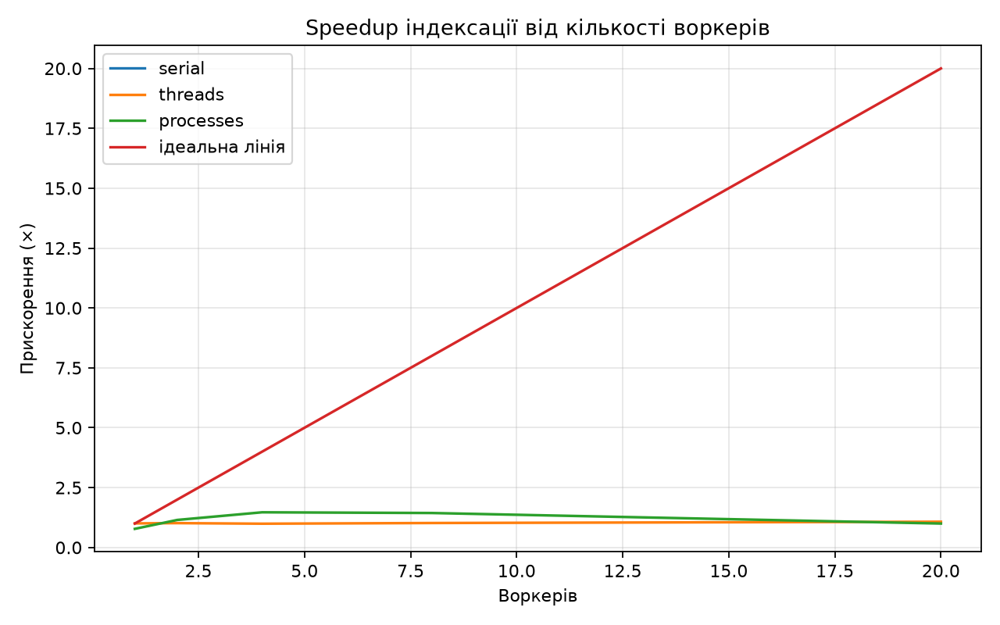

# findex — журнал лабораторних робіт 1–7

Повні звіти лабораторних у тому вигляді, в якому вони здавались (Lab 8 і зведені виміри — у [README](../README.md)). Числа в таблицях — з фактичних запусків на машинах автора; корпус Lab 1–5 — синтетичний (`benchmarks/make_demo_corpus.py`), Lab 6 — локальне дзеркало, Lab 7 — 744 PEP.

## Лабораторна робота №1

**Тема:** ітератори, генератори та корпус текстів.

Реалізовано `iter_documents()`, потоковий `tokenize()` з Unicode NFC та `casefold()`, однопрохідну статистику, `--limit`, `tracemalloc` і порівняння lazy/eager.

## Лабораторна робота №2

**Тема:** інвертований індекс, словники, хешування та пам'ять.

Реалізовано `Posting`/`DocMeta` через `@dataclass(frozen=True, slots=True)`, інвертований індекс через `defaultdict`, Boolean-пошук `AND/OR/NOT`, двигуни `merge/set`, `pickle` + `JSON` та порівняння `plain/slots/array('I')`.

### Результати Lab 2

#### Merge vs set

| Терм | Група | Двигун | Результатів | Загальний час (с) | Середній час (мс) |
|---|---|---|---:|---:|---:|
| токен | common | merge | 300 | 0.000959 | 0.0048 |
| токен | common | set | 300 | 0.000969 | 0.0048 |
| пошук | common | merge | 300 | 0.000998 | 0.0050 |
| пошук | common | set | 300 | 0.000950 | 0.0047 |
| raretoken0001 | rare | merge | 1 | 0.000193 | 0.0010 |
| raretoken0001 | rare | set | 1 | 0.000205 | 0.0010 |
| raretoken0002 | rare | merge | 1 | 0.000200 | 0.0010 |
| raretoken0002 | rare | set | 1 | 0.000201 | 0.0010 |

#### Серіалізація

| Формат | Розмір (MiB) | Save (с) | Load (с) |
|---|---:|---:|---:|
| pickle | 0.26 | 0.020832 | 0.018150 |
| JSON | 0.41 | 0.033599 | 0.013174 |

#### Пам'ять

| Варіант | Документи | Пікова пам'ять (MiB) | Розмір pickle (MiB) | Save (с) | Load (с) |
|---|---:|---:|---:|---:|---:|
| plain | 300 | 2.39 | 0.31 | 0.010769 | 0.006774 |
| slots | 300 | 1.72 | 0.24 | 0.018702 | 0.015783 |
| array | 300 | 0.90 | 0.15 | 0.001073 | 0.000246 |

`slots=True` прибирає окремий `__dict__` екземпляра, а `array('I')` зберігає числові значення щільніше, без окремого Python-об'єкта для кожного числа.

## Лабораторна робота №3

**Тема:** рейтинг і модель об'єктів — dunder-методи, протоколи, декоратори.

Лабораторна продовжує корпус і індекс з перших двох робіт. Вимоги: `Index` як Python-подібний об'єкт, `Scorer` з TF-IDF/BM25, дерево Boolean-запитів, контекстний менеджер, `@timed`, `lru_cache`, сніпети та P@5. Джерело: [методичка Lab 3](https://github.com/rmalkevy/Programming-Practice-Projects/blob/main/courses/python/lab-03-the-object-model-and-ranking.md).

### 1. Об'єкт `Index`

Підтримуються:

```python
len(index)
"python" in index
index["python"]
for term in index:
    ...
repr(index)
index.num_docs
index.avg_doc_length
index.doc_length(doc_id)
index.df(term)
```

`Index` реалізує `collections.abc.Mapping`. `avg_doc_length` є `cached_property`. `open_index(path)` завжди викликає `close()` у `finally`, включно з випадками, коли тіло `with` завершується винятком.

### 2. TF-IDF та BM25

Є протокол `Scorer` і дві взаємозамінні реалізації:

```python
TfIdf()
BM25(k1=1.5, b=0.75)
```

Для top-k використовується `heapq.nlargest`, а результат має форму `SearchResult(doc_id, score, title, snippet)` з `order=True`.

### 3. Санітарні перевірки рейтингу

Команда:

```powershell
uv run python benchmarks/sanity_lab3.py
```

Перевіряє три властивості:

1. рідкісний терм має більшу TF-IDF вагу, ніж частий;
2. 20-та повторна поява слова в BM25 дає малий додатковий приріст;
3. за однакового `tf` короткий документ має вищий BM25 бал, ніж дуже довгий.

### 4. Мова запитів

Парсер підтримує:

```text
python AND (async OR await) NOT java "event loop"
```

Вузли дерева: `Term`, `Phrase`, `And`, `Or`, `Not`. Підтримані `&`, `|`, `~`, неявний `AND`, `OR`, `NOT`, дужки та фрази.

Фразові запити використовують позиції токенів. Індекс треба будувати з `--positions`:

```powershell
uv run python -m findex.index data/ --out index.bin --positions
```

### 5. Decorator та cache

`@timed` з `functools.wraps` використовується для `build`, `load`, `search`. Шлях `query -> result ids` кешується через `@lru_cache(maxsize=256)`.

При повторному запиті у CLI видно `cache info` з `hits`:

```powershell
uv run python -m findex.search index.bin "python search" -k 5
```

### 6. Сніпети

Для результату формується вікно приблизно ±80 символів навколо першого найкращого входження, а терми підсвічуються через `**...**`.

### 7. Precision@5

Для детермінованого корпусу Lab 1/2 використані 10 ручних міток. Для common-термів релевантними вважаються всі документи, для `raretoken0001...0005` — відповідні документи `doc-0001...doc-0005`. Скрипт:

```powershell
uv run python benchmarks/evaluate_lab3.py data/benchmark --limit 300
```

Результат виводиться як таблиця для README. Precision@5 рахується як кількість релевантних документів у top-5, поділена на 5.

| Запит | TF-IDF P@5 | BM25 P@5 |
|---|---:|---:|
| python | 1.00 | 1.00 |
| search | 1.00 | 1.00 |
| generators | 1.00 | 1.00 |
| tokenizes | 1.00 | 1.00 |
| unicode | 1.00 | 1.00 |
| raretoken0001 | 0.20 | 0.20 |
| raretoken0002 | 0.20 | 0.20 |
| raretoken0003 | 0.20 | 0.20 |
| raretoken0004 | 0.20 | 0.20 |
| raretoken0005 | 0.20 | 0.20 |

Після запуску значення з власної машини треба вставити сюди.

### Reflection — Lab 3

1. Що викликають `len(index)`, `term in index` та `index[term]`?
2. Чим `typing.Protocol` відрізняється від ABC?
3. Навіщо `functools.wraps` у `@timed`?
4. Як структурно відрізняється декоратор із параметрами?
5. Що відбувається до і після `yield` у `@contextmanager`?
6. Що контролюють `k1` і `b` у BM25?
7. Чому `heapq.nlargest(k, ...)`, а не `sorted(...)[:k]`?
8. Чому `a OR b c` парситься як `Or(a, And(b, c))`?

## Лабораторна робота №4

**Тема:** типізація, тестування, пакування та CLI.

### Реалізовано

- строгі типи для публічного API та `Scorer` через `typing.Protocol`;
- `Iterator` / `Iterable` для потокового API;
- `Literal` для `engine`, `scorer` та форматів;
- `pytest` із фікстурою `tests/conftest.py` та параметризованими тестами;
- property-based тести через Hypothesis;
- покриття через `pytest-cov`;
- `pyproject.toml` з PEP 621 метаданими, dev-залежностями та `[project.scripts]`;
- команда `findex` з підкомандами `index`, `search`, `stats`;
- Rich progress bar для побудови індексу та Rich table для пошуку;
- `findex search --json` для JSON Lines у `stdout`;
- `-v` і `-vv` для рівня логування;
- діагностика через `logging` у `stderr`;
- GitHub Actions: Ruff, Ruff format, Pyright strict, pytest + coverage;
- SonarQube Cloud із coverage report.

### Фактичні результати Lab 4

- версія пакета: `findex 0.4.0`;
- зібрано wheel та source distribution командою `uv build`;
- CLI має підкоманди `index`, `search`, `stats`;
- у контрольному прогоні coverage Lab 4 зафіксовано `58%`;
- CI запускає Ruff, Ruff format, Pyright strict та pytest + coverage;
- SonarQube Cloud використовується для перевірки Quality Gate.

### Запуск як встановленого інструмента

```powershell
uv sync
uv run findex --help
```

Побудова індексу:

```powershell
findex index data/ --out index.bin --positions
```

Пошук:

```powershell
findex search index.bin "python AND (search OR token)" --scorer bm25 -k 5
```

JSON Lines у stdout:

```powershell
findex search index.bin "python search" --json -k 5 > results.jsonl
```

Статистика:

```powershell
findex stats index.bin
```

Рівні логування:

```powershell
findex -v search index.bin "python"
findex -vv search index.bin "python"
```

### Перевірка типів і тестів

```powershell
uv run pyright
uv run ruff check .
uv run ruff format --check .
uv run pytest --cov=findex --cov-report=term-missing
```

Тести, які зазвичай працюють довше секунди, треба запускати з маркером `slow` і за потреби виключати через `-m "not slow"`.

### Пакування

```powershell
uv build
```

У каталозі `dist/` з'являться wheel та інші артефакти пакування. Перевірка ізольованого запуску:

```powershell
uvx --from dist\findex-0.4.0-py3-none-any.whl findex --help
```

Встановлення як CLI-інструмента:

```powershell
uv tool install .
findex --help
```

### Покриття

Фактичний відсоток покриття залежить від запуску тестового набору. Перед здачею потрібно виконати:

```powershell
uv run pytest --cov=findex --cov-report=term-missing
```

і перенести підсумковий відсоток у цей README. Свідомо поза повним покриттям можуть залишитися рідкісні гілки помилок I/O, захист від пошкоджених зовнішніх файлів та окремі compatibility-обгортки старих CLI `python -m ...`.

### CI

CI на GitHub Actions запускає `uv sync`, `ruff check`, `ruff format --check`, `pyright` у strict mode та `pytest` із coverage на кожен push і Pull Request.


### Реліз v0.4.0

Після успішного CI та перевірки пакування створюється Git-тег `v0.4.0`. Wheel формується командою `uv build` і прикріплюється до GitHub Release `v0.4.0`.

Команди: 

```powershell
uv sync
uv run pyright
uv run ruff check .
uv run ruff format --check .
uv run pytest --cov=findex --cov-report=term-missing
uv build
uv tool install dist\findex-0.4.0-py3-none-any.whl
findex --help
```

Після перевірки релізу: 

```powershell
git tag v0.4.0
git push origin v0.4.0
```

У GitHub створіть Release `v0.4.0` і прикріпіть wheel з каталогу `dist/`.

### Покриття Lab 4

У контрольному прогоні на базових тестах Lab 1–3 отримано 58% покриття. Остаточне число для звіту потрібно отримати повним запуском Lab 4 після встановлення `hypothesis`, `pytest-cov` та нових CLI-тестів:

```powershell
uv run pytest --cov=findex --cov-report=term-missing
```

За межами цільового покриття залишаються переважно рідкісні гілки помилок I/O, пошкоджених зовнішніх файлів та старі compatibility-обгортки `python -m ...`; основний CLI, пошук, парсер, серіалізація і типізований API покриваються тестами.

## Лабораторна робота №5

**Тема:** конкурентність і GIL: потоки, процеси і паралельна індексація.

### Реалізовано

- винесено індексацію одного набору документів у module-level `build_partial()`;
- додано `merge()` для детермінованого об'єднання partial-індексів;
- `findex index` підтримує `--workers N` та `--executor {serial,threads,processes}`;
- для `ProcessPoolExecutor` передаються шляхи до файлів, а не завантажені тексти;
- для процесів використовується spawn-safe схема;
- worker exceptions не приховуються та доходять до CLI з traceback;
- serial, threads і processes дають байт-ідентичний pickle-індекс;
- додано benchmark із wall time, CPU time, Peak RSS, merge time та speedup;
- додано графік `docs/lab05_speedup.png`;
- додано експеримент `benchmarks/gil_experiments.py` для GIL та race condition;
- перевірено free-threaded Python 3.13 (`3.13t`);
- default executor встановлено як `processes` після benchmark на використаній машині.

### 1. CLI

Довідка команди:

```powershell
uv run findex index --help
```

Поточні параметри:

```text
--workers <int>                    default: 1
--executor <serial|threads|processes>
                                   default: processes
```

Приклад явного serial-запуску:

```powershell
uv run findex index data/ --out index-serial.bin --workers 1 --executor serial
```

Паралельний запуск процесами:

```powershell
uv run findex index data/ --out index-processes.bin --workers 4 --executor processes
```

Потоковий запуск:

```powershell
uv run findex index data/ --out index-threads.bin --workers 4 --executor threads
```

### 2. Детермінованість індексу

Для корпусу з 300 документів були створені три індекси:

- serial, 1 worker;
- processes, 4 workers;
- CPython 3.13t, threads, 4 workers.

SHA-256 усіх трьох файлів однаковий:

```text
456D206D6E6C4BC0DC131530A28B0CE309FCB2F9FE07C4B4EDDE20B331128FEF
```

Статистика також однакова:

| Показник | Значення |
|---|---:|
| Документи | 300 |
| Словник | 357 |
| Середня довжина | 5521.00 |
| Токени | 1,656,300 |

Це підтверджує, що конкурентна побудова не змінює зміст інвертованого індексу.

### 3. Benchmark

Повний запуск:

```powershell
uv run python benchmarks/benchmark_parallel.py data/ --repeats 3
```

Параметри машини:

| Параметр | Значення |
|---|---|
| OS | Windows 11 10.0.26100 |
| CPU | Intel64 Family 6 Model 151 Stepping 2 |
| Фізичні ядра | 12 |
| Логічні CPU | 20 |
| Python | 3.13.15 |
| Варіант | CPython 3.13 (GIL) |
| Корпус | `data/` |
| Документів | 300 |
| Повторів на комірку | 3 |

#### Результати

| Executor | Workers | Wall (s, median) | CPU (s) | Peak RSS (MiB) | Merge (s) | Speedup |
|---|---:|---:|---:|---:|---:|---:|
| serial | 1 | 0.9874 | 0.9688 | 70.65 | 0.0017 | 1.00× |
| threads | 1 | 0.9814 | 0.9531 | 71.80 | 0.0019 | 1.01× |
| threads | 2 | 0.9703 | 0.9688 | 72.41 | 0.0017 | 1.02× |
| threads | 4 | 0.9940 | 0.9844 | 72.69 | 0.0017 | 0.99× |
| threads | 8 | 0.9661 | 0.9844 | 72.85 | 0.0018 | 1.02× |
| threads | 20 | 0.9183 | 0.9375 | 74.22 | 0.0019 | 1.08× |
| processes | 1 | 1.2687 | 1.6250 | 75.23 | 0.0016 | 0.78× |
| processes | 2 | 0.8585 | 1.7656 | 75.68 | 0.0018 | 1.15× |
| processes | 4 | 0.6720 | 2.6719 | 75.68 | 0.0017 | 1.47× |
| processes | 8 | 0.6859 | 4.9844 | 75.70 | 0.0021 | 1.44× |
| processes | 20 | 0.9874 | 16.2344 | 75.80 | 0.0036 | 1.00× |

У цьому запуску найменший wall time отримано для `processes / 4`: `0.6720 s`, speedup `1.47×` відносно serial. Подальше збільшення до 8 процесів не покращило результат, а 20 процесів повернули час до рівня serial через накладні витрати.

Фракція послідовного merge:

```text
0.17%
```

Теоретична верхня межа за законом Амдала для цієї частки:

```text
≈ 585.56×
```

Графік speedup:



### 4. GIL і потоки

Експеримент на звичайному CPython 3.13.15:

```powershell
uv run python benchmarks/gil_experiments.py --n 10000000 --iterations 1000000
```

Результати:

| Режим | Час |
|---|---:|
| one | 0.4273 s |
| two serial | 0.8637 s |
| two threads | 0.8886 s |
| two processes | 0.5312 s |

`sys._is_gil_enabled()` повернув `True`.

Для CPU-bound чистого Python потоки у звичайному CPython не дали справжнього паралельного виконання bytecode, а два процеси дали менший wall time.

### 5. Race condition

Експеримент із `counter += 1`:

```text
race expected:      2000000
race unsafe result: 1157000
race locked result: 2000000
```

Отже, сам GIL не гарантує коректність користувацьких інваріантів. Спільний mutable state потрібно синхронізувати, наприклад через `threading.Lock`, або уникати спільного стану.

### 6. Free-threaded Python 3.13

Встановлено окремий free-threaded інтерпретатор:

```powershell
uv python install 3.13t
```

Перевірка:

```powershell
uv run --python 3.13t --no-dev python -c "import sys; print(sys.version); print('GIL enabled:', sys._is_gil_enabled())"
```

Результат:

```text
CPython 3.13.15+freethreaded
GIL enabled: False
```

Через відсутність сумісного wheel для `kiwisolver==1.5.1` у dev-наборі на цьому середовищі free-threaded перевірки запускалися з `--no-dev`; сам GIL-експеримент і CLI індексації не потребують `matplotlib`.

Експеримент на `3.13t`:

```powershell
uv run --python 3.13t --no-dev python benchmarks/gil_experiments.py --n 10000000 --iterations 1000000
```

| Режим | Час |
|---|---:|
| one | 0.4599 s |
| two serial | 0.9424 s |
| two threads | 0.4603 s |
| two processes | 0.5632 s |

`sys._is_gil_enabled()` повернув `False`. У цьому експерименті два CPU-bound потоки мали wall time `0.4603 s` проти `0.9424 s` для двох послідовних запусків.

Race condition залишився:

```text
race expected:      2000000
race unsafe result: 1202847
race locked result: 2000000
```

Отже, free-threading не усуває необхідність синхронізації спільного змінюваного стану.

### 7. Threaded indexing на 3.13t

```powershell
uv run --python 3.13t --no-dev findex index data/ --out index-threads-313t.bin --workers 4 --executor threads
```

Результат:

```text
документів: 300
термів: 357
```

Статистика:

```text
середня довжина: 5521.00
токени: 1,656,300
```

SHA-256 цього індексу збігся із serial та processes індексами, тому навіть free-threaded threaded build дає той самий детермінований результат.

### 8. Перевірка Lab 5

Фінальний локальний прогін:

```powershell
uv run ruff check .
uv run ruff format --check .
uv run pyright
uv run pytest --basetemp .pytest_tmp -p no:cacheprovider
```

Результат:

```text
Ruff:    All checks passed!
Format:  32 files already formatted
Pyright: 0 errors, 0 warnings, 0 informations
Pytest:  61 passed
```

### Посилання на методичку Lab 5

- Lab 5: https://github.com/rmalkevy/Programming-Practice-Projects/blob/main/courses/python/lab-05-concurrency-and-the-gil.md
- Теорія та досліди: https://github.com/rmalkevy/Programming-Practice-Projects/blob/main/courses/python/lab-05-concurrency-and-the-gil.notes.md

### Reflection — Lab 5

1. Чому CPU-bound `findex` не отримує повного прискорення від `ThreadPoolExecutor` у звичайному CPython?
2. Навіщо для `ProcessPoolExecutor` передавати шляхи до файлів, а не тіла документів?
3. Чому функції воркерів мають бути module-level і picklable?
4. Чому `counter += 1` не є достатньо надійним для спільного mutable state?
5. Що показав експеримент на `3.13t` без GIL?
6. Чому для 20 процесів швидкодія погіршилась порівняно з 4 процесами?
7. Що означає послідовний merge для закону Амдала?
8. Які накладні витрати з'являються при використанні процесів?

## Зауваження щодо pickle

`pickle` зручний для швидкої серіалізації Python-об'єктів, але завантаження чужого або підмінного `.bin` є небезпечним: під час десеріалізації pickle може виконувати код через механізм відновлення об'єктів. Тому `pickle`-файл потрібно завантажувати лише з довіреного джерела. Для менш довіреного обміну використовується JSON.

## Запуск

У корені проєкту:

```powershell
uv sync
uv run pytest
uv run ruff check .
```

Створення demo-корпусу:

```powershell
uv run python benchmarks/make_demo_corpus.py data/benchmark --documents 300 --copies-per-document 80
```

Побудова індексу:

```powershell
uv run python -m findex.index data/benchmark --out index.bin --positions
```

Пошук:

```powershell
uv run python -m findex.search index.bin 'python AND (search OR token) NOT java "search engine"' -k 10
```

JSON:

```powershell
uv run python -m findex.index data/benchmark --out index.json --format json --positions
uv run python -m findex.search index.json "python search" -k 10
```

Контекстний API:

```python
from findex.store import open_index
from findex.ranking import BM25

with open_index("index.bin") as index:
    results = index.search("python search", scorer=BM25(), k=5)
```

## Структура

```text
findex/
├── .github/workflows/sonar.yml
├── benchmarks/
│   ├── make_demo_corpus.py
│   ├── benchmark_search.py
│   ├── benchmark_storage.py
│   ├── measure_lab2.py
│   ├── sanity_lab3.py
│   ├── evaluate_lab3.py
│   ├── benchmark_parallel.py
│   └── gil_experiments.py
├── data/
├── src/findex/
│   ├── corpus.py
│   ├── tokenize.py
│   ├── stats.py
│   ├── benchmark.py
│   ├── index.py
│   ├── search.py
│   ├── store.py
│   ├── ranking.py
│   ├── query.py
│   ├── snippets.py
│   ├── timing.py
│   └── parallel.py
├── tests/
├── pyproject.toml
├── sonar-project.properties
├── uv.lock
└── README.md
```

## Git workflow

Лабораторні розділяються окремими гілками та Pull Request у тому самому публічному репозиторії:

```text
main
 ├── tag lab-01
 ├── lab-02 → PR → main → tag lab-02
 ├── lab-03 → PR → main → tag lab-03
 ├── lab-04 → PR → main → tag lab-04
 └── lab-05 → PR → main → tag lab-05
```

Корпус у `data/` не комітиться.

## Посилання на методички

- Lab 3: https://github.com/rmalkevy/Programming-Practice-Projects/blob/main/courses/python/lab-03-the-object-model-and-ranking.md
- Теорія та досліди Lab 3: https://github.com/rmalkevy/Programming-Practice-Projects/blob/main/courses/python/lab-03-the-object-model-and-ranking.notes.md
- Lab 5: https://github.com/rmalkevy/Programming-Practice-Projects/blob/main/courses/python/lab-05-concurrency-and-the-gil.md
- Теорія та досліди Lab 5: https://github.com/rmalkevy/Programming-Practice-Projects/blob/main/courses/python/lab-05-concurrency-and-the-gil.notes.md

## Примітка щодо числових результатів

У README залишені лише результати, які були зафіксовані в матеріалах роботи та фактичних запусках проєкту. Для Lab 1 у вихідному README є опис реалізованих можливостей, але окремі числові значення lazy/eager та `tracemalloc` не збережені, тому вони не вигадуються.

## Лабораторна робота №6

**Тема:** асинхронний краулер — `asyncio`, HTTP-запити, `TaskGroup`, черги, семафори та потоковий JSONL.

### Реалізовано

- `findex crawl` — асинхронний генератор сторінок на основі `asyncio.Queue` і `asyncio.TaskGroup`;
- один глобальний семафор, окремі семафори на origin і мінімальний інтервал між запитами до того самого origin;
- HTTP-клієнт `httpx.AsyncClient`, `asyncio.timeout`, обмежені повтори для `429`, `5xx` і таймаутів, exponential backoff, jitter та `Retry-After`;
- ручна обробка редиректів із блокуванням циклів і переходів за межі allowlist;
- `RobotsCache` — кеш robots policy для кожного origin; недоступний/помилковий `robots.txt` блокує краул, `404/410` означає, що правил немає;
- canonicalization URL: lower-case схема/host, прибрані fragment і trailing slash, відсортовані query-параметри;
- `seen` для запобігання дублям і верхня межа `--max-pages`;
- витягування title, тексту й посилань через стандартний `html.parser`;
- JSONL записується рядок за рядком; серіалізація/запис виводяться в `asyncio.to_thread`, а індексація залишається окремою командою;
- `Rich` live counters: сторінки, pages/s, запити in-flight, помилки й глибина черги;
- `crawl.log` містить статус, кількість байтів, час запиту та номер спроби;
- тести для HTTP виконуються через `httpx.MockTransport`, без живої мережі.

### Дозвіл на краул і User-Agent

Для перевірки та benchmark використовується **локальне дзеркало, створене `benchmarks/local_mirror.py` і прив'язане лише до `127.0.0.1`**. Воно знаходиться під контролем автора проєкту; його `robots.txt` дозволяє обхід. Зовнішній сайт для benchmark не використовується. User-Agent вказує репозиторій та контакт, переданий через обов'язковий `--contact`. Якщо запускаєте краулер на будь-якому публічному сайті, робіть це лише з дозволом, перевірте його robots.txt і вкажіть власний реальний email.

### Запуск краулера

У першому PowerShell вікні запустіть локальне дзеркало щонайменше на 250 сторінок:

```powershell
uv run python benchmarks/local_mirror.py --pages 250 --delay 0.01
```

Дзеркало навмисно має невелику затримку відповіді, щоб було видно різницю між конкурентністю 1, 5 і 20. Воно слухає лише loopback-інтерфейс.

У другому вікні:

```powershell
uv run findex crawl http://127.0.0.1:8765/page/0 --contact YOUR_REAL_EMAIL@example.com --max-pages 200 --concurrency 20 --per-host 20 --per-host-delay 0 --out data/crawl.jsonl --log-file crawl.log
```

Замініть `YOUR_REAL_EMAIL@example.com` на свою справжню контактну адресу. Для звичайного краулу defaults залишаються обережнішими: `--per-host 2` та `--per-host-delay 0.2`. У benchmark локального дзеркала per-host limit навмисно послаблюється, бо цей сервер належить автору проєкту.

Після завершення краулу індекс будується **поза event loop**. JSONL обробляється по одному рядку як по одному документу:

```powershell
uv run findex index data/crawl.jsonl --out index-crawl.bin --workers 4 --executor processes
uv run findex search index-crawl.bin "asyncio" -k 5
```

### Benchmark: concurrency 1 / 5 / 20

Залиште локальне дзеркало запущеним. Команда використовує той самий seed, той самий `max_pages=200`, три повтори й ті самі per-host параметри для всіх варіантів:

```powershell
uv run python benchmarks/benchmark_crawl.py --contact YOUR_REAL_EMAIL@example.com --max-pages 200 --repeats 3 --per-host 20 --per-host-delay 0
```

Скрипт вимірює wall time, сторінки за секунду, помилки з URL-логів і Peak RSS. Markdown-таблиця також записується до `data/lab06-benchmark/table.md`; після запуску перенесіть **реальні рядки з вашої машини** в таблицю нижче.

| Concurrency | Pages (median) | Wall (s, median) | Pages/s | Errors (median) | Peak RSS (MiB, median) |
|---:|---:|---:|---:|---:|---:|
| 1 | 200 | 4.218 | 47.42 | — | 5.43 MiB |
| 5 | 200 | 2.182 | 91.67 | — | 5.43 MiB |
| 20 | 200 | 2.078 | 96.25 | — | 5.43 MiB |

Не підставляйте в цю таблицю числа з іншого комп'ютера — результати залежать від затримки дзеркала, Python, ОС і навантаження машини.

### Інтерпретація

Краулер майже весь час очікує мережеву відповідь. `asyncio` дає одному потоку перемикатися на інші задачі в `await`, поки сокет чекає відповіді. Це відрізняється від Lab 5: індексація CPU-bound, тому там процеси допомагають виконувати Python-код паралельно; у краулері процеси не потрібні для перекриття мережевих очікувань.

Обмеження на host зменшує максимальну швидкість, особливо коли сторінки беруться з одного домену. Воно залишається заради ввічливого навантаження на сервер і дотримання robots policy. Значення `--per-host 20 --per-host-delay 0` використовуються **тільки** для локального дзеркала в контрольованому benchmark, а не як рекомендовані налаштування для публічних сайтів.

Якби токенізація та індексація запускалися всередині корутини синхронним CPU-кодом, event loop не міг би перемикатися на інші запити до завершення цієї роботи. Тому краулер витягує текст, пише JSONL потоково, а `findex index` запускається окремо після завершення мережевого обходу.

### Приклад обробленого збою: HTTP 429

Локальне дзеркало має endpoint `/flaky429`: він повертає один `429` з `Retry-After: 0`, а наступний запит успішний. Для відтворення виконайте:

```powershell
uv run findex crawl http://127.0.0.1:8765/flaky429 --contact YOUR_REAL_EMAIL@example.com --max-pages 2 --concurrency 2 --per-host 2 --per-host-delay 0 --out data/failure-example.jsonl --log-file docs/lab06_failure.log
```

Приклад фактичних рядків з локального тестового запуску (час і `elapsed` у вашому запуску відрізнятимуться):

```text
INFO url=http://127.0.0.1:8765/flaky429 status=429 bytes=0 elapsed=0.004s attempt=1
WARNING url=http://127.0.0.1:8765/flaky429 status=429 action=retry delay=0.000s attempt=1/3
INFO url=http://127.0.0.1:8765/flaky429 status=200 bytes=105 elapsed=0.004s attempt=2
```

Тобто `429` не завершив увесь краул: клієнт виконав одну повторну спробу згідно з `Retry-After`, записав фінальну успішну сторінку, а лог залишив обидва статуси.

### Перевірки Lab 6

```powershell
uv run ruff check .
uv run ruff format --check .
uv run pyright
uv run pytest --basetemp .pytest_tmp -p no:cacheprovider
```

Методичка: [Lab 6 — Asyncio crawler](https://github.com/rmalkevy/Programming-Practice-Projects/blob/main/courses/python/lab-06-asyncio-crawler.md) · [Нотатки](https://github.com/rmalkevy/Programming-Practice-Projects/blob/main/courses/python/lab-06-asyncio-crawler.notes.md)

### Reflection — Lab 6

1. Що відбувається в event loop, коли корутина доходить до `await` на читанні сокета?
2. Чому `time.sleep()` блокує інші задачі, а `asyncio.sleep()` — ні?
3. Чому `TaskGroup` краще пасує до керованих worker-задач, ніж fire-and-forget?
4. Чому треба одночасно обмежувати глобальну конкурентність і кількість запитів до одного host?
5. Як `Retry-After` змінює звичайний exponential backoff?
6. Чому `counter += 1` і спільний змінюваний стан вимагають синхронізації, навіть якщо програма асинхронна?
7. Чому індексація має виконуватися після краулу, а не всередині корутини?

## Лабораторна робота №7

**Тема:** пошук у вебі — ASGI, FastAPI, Pydantic, `Depends` і `lifespan`, `def` vs `async def`, конфіг з оточення, Docker, деплой, навантажувальне тестування.

### Корпус для демо

Синтетичний корпус з Lab 1 (300 однакових документів) не годиться для сторінки, яку показують чужій людині, тому для веб-версії взято реальний текст: **744 Python Enhancement Proposals** з репозиторію [python/peps](https://github.com/python/peps) (public domain / CC0). Скрипт `benchmarks/make_pep_corpus.py` перетворює `.rst` на JSONL того самого формату, що пише краулер з Lab 6 (`url`, `title`, `text`), тож індексується звичайним `findex index`. Знімок корпусу лежить у `corpus/peps.jsonl.gz` (4 МБ), щоб збірка Docker не залежала від мережі.

| Корпус | Документів | Словник | Постингів | Середня довжина | Індекс (pickle, з позиціями) |
|---|---:|---:|---:|---:|---:|
| PEPs @ `6068058` | 744 | 31 753 | 481 435 | 2 722.67 токена | 14.6 МБ |

### Реалізовано

- `src/findex/web/` — FastAPI-застосунок:
  - `settings.py` — `Settings(BaseSettings)`: `INDEX_PATH`, `LOG_LEVEL`, `LOG_FORMAT`, `SEARCH_ROUTE`; читається з оточення або `.env`, у коді немає шляхів;
  - `state.py` — `lifespan` один раз на процес завантажує індекс у потоці (`asyncio.to_thread`), поки сервер уже відповідає; залежності `get_state` → `get_loaded_index` → `get_index` (503, поки індекс не готовий);
  - `models.py` — Pydantic-моделі **лише на межі**: `SearchResponse`, `SearchHit`, `DocumentResponse`, `StatsResponse`, `HealthResponse`, `ErrorResponse`;
  - `service.py` — перетворення: всередині працюють dataclass-и з Lab 2–3 (`Posting`, `DocMeta`, `SearchResult`), назовні — Pydantic;
  - `app.py` — маршрути, middleware з `X-Request-ID`, access-log і чистою відповіддю 500;
  - `logs.py` — логи в stdout, текстові або JSON (`LOG_FORMAT=json`), з `request_id` у кожному рядку;
  - `templates/` + `static/` — сторінка пошуку на Jinja2 + htmx.
- `findex serve [--index PATH] [--port 8000] [--workers N]` — обгортка над uvicorn (`PORT` і `WEB_CONCURRENCY` теж читаються з оточення).
- `Dockerfile` (два етапи, `uv.lock`, non-root), `.dockerignore`, `render.yaml`.

### API

| Маршрут | Що повертає | Коди |
|---|---|---|
| `GET /search?q=&k=&scorer=&page=` | `SearchResponse{query, scorer, page, k, total, pages, took_ms, results[]}` | 200, 422 (валідація або нерозбірний запит), 503 |
| `GET /docs/{doc_id}` | повний текст і метадані документа | 200, 404, 422 |
| `GET /stats` | документи, словник, постинги, розмір файлу, час завантаження, uptime | 200, 503 |
| `GET /health` | `{"status": "ok"}` / `loading` / `error` | 200, 503 |
| `GET /docs` | OpenAPI (Swagger UI), згенерований FastAPI | 200 |

Обмеження параметрів задані типами: `q: str` 1–200 символів, `k: int` 1–50, `page: int` 1–100, `scorer: Literal["bm25", "tfidf"]`. Невідомий `scorer` чи `k=abc` → 422 з тілом `{"detail": [...]}` від Pydantic; синтаксична помилка в запиті (`(python`) → 422 `{"detail": "Invalid query: ..."}`.

Пагінація: `top_k` тримає купу з `page·k` елементів (O(n log(page·k))), сніпети будуються лише для сторінки, що повертається.

Неочікуваний виняток: у лог іде повний стек з `request_id`, клієнт отримує тільки
`{"detail": "Internal Server Error", "request_id": "..."}` — той самий id, що в заголовку `X-Request-ID`, за ним рядок легко знайти в логах платформи.

```text
2026-10-17 14:30:09,843 INFO [a4bc213da7924a3c] findex.web: GET /doc/390 -> 200 4.8 ms
```

### Сторінка пошуку

`GET /` — поле запиту, перемикач BM25/TF-IDF, результати з підсвіткою (`<mark>`), бали, посилання на оригінал на peps.python.org, перехід між сторінками. `GET /doc/{id}?q=...` — перегляд документа з підсвіченими термами запиту. htmx оновлює лише блок результатів під час набору (`/ui/results`, затримка 300 мс), а адресний рядок лишається на звичайному `/?q=...` (заголовок `HX-Push-Url`), тож посиланням можна поділитися. Без JavaScript форма працює звичайним GET.

Сніпет: вікно ±120 символів ставиться там, де поруч зустрічається найбільше **різних** термів запиту (ковзне вікно по входженнях, O(кількість входжень)), а не на першому входженні будь-якого терма. Весь текст екранується Jinja2, `<mark>` додається лише навколо збігів — тест перевіряє, що `<script>` у запиті не виконується.

### Тести

`tests/test_web.py` — 34 тести через `TestClient` і `app.dependency_overrides[get_index]`, без справжнього файлу індексу (крім двох тестів самого `lifespan`, які зберігають крихітний індекс у `tmp_path`):

- успішний пошук, TF-IDF + Boolean-запит, пагінація, порожній результат;
- 422 для кожного невалідного параметра і для нерозбірного запиту;
- `/docs/{id}`: 200, 404, 422 для нечислового id;
- `/health` → 503, коли індекс не завантажений; 503 з `status=error`, коли файлу немає; `/search` і `/stats` → 503;
- чистий 500 без стека і з `request_id` у лозі;
- варіанти `def` і `async def` повертають однакові результати;
- сторінка: підсвітка, екранування, повідомлення про помилку запиту, htmx-фрагмент, перегляд документа, CSS;
- `findex serve` викликає `uvicorn.run` з правильними параметрами.

### `def` чи `async def`: 20 одночасних запитів

`benchmarks/web_concurrency.py` піднімає справжній uvicorn (1 воркер) з `SEARCH_ROUTE=def` і `SEARCH_ROUTE=async`, шле 20 одночасних `GET /search?q=python type annotations` і паралельно весь час пінгує `/health`. Медіана з 5 серій, 2 vCPU, Python 3.13:

| Маршрут | Усі 20 (мс) | Найшвидший пошук (мс) | p50 пошуку (мс) | Найповільніший (мс) | `/health` p50 під навантаженням (мс) | `/health` max (мс) | Відповідей `/health` за серію |
|---|---:|---:|---:|---:|---:|---:|---:|
| `def` (пул потоків) | 472 | 56 | 435 | 480 | 38.2 | 141 | 9 |
| `async def` (на event loop) | 372 | 24 | 352 | 384 | 5.6 | 348 | 4 |

Сам пошук (~18 мс CPU на запит) у `async def` навіть трохи швидший: запити йдуть строго по черзі, без перемикання потоків і боротьби за GIL. Але поки триває серія, цикл подій зайнятий: `/health` чекав до 348 мс, тобто всю серію, і за серію встиг відповісти лише 4 рази. З `def` FastAPI віддає роботу в пул потоків, цикл вільний, і `/health` відповідає не пізніше ніж за 141 мс навіть під час серії. Платформа, яка перевіряє `/health` з таймаутом, з `async def` вважала б сервіс мертвим під навантаженням. **У коді лишається `def`**; `SEARCH_ROUTE=async` залишено лише як перемикач для цього досліду.

### Docker

```bash
docker build -t findex .
docker run --rm -p 8000:8000 findex                       # індекс уже всередині образу
docker run --rm -p 8000:8000 -e INDEX_PATH=/data/peps.bin -v "$PWD/data:/data:ro" findex
```

- етап `builder` (`ghcr.io/astral-sh/uv:python3.13-bookworm-slim`): спершу `uv sync --locked --no-install-project` лише за `uv.lock` (кешований шар), потім сам проєкт як звичайний пакет (`--no-editable`), потім `findex index` будує індекс з `corpus/peps.jsonl.gz`;
- етап `runtime` (`python:3.13-slim-bookworm`): лише `.venv` і `data/`, користувач `findex` (uid 10001), `HEALTHCHECK` на `/health`, `CMD ["findex", "serve", "--host", "0.0.0.0"]`;
- образ перевірено локально: `id` у контейнері → `uid=10001(findex)`, `docker inspect` → `healthy`, пам'ять процесу ~250 МіБ (вміщається в безкоштовні 512 МБ Render).

### Деплой (Render)

1. <https://dashboard.render.com> → **New → Blueprint** → підключити цей репозиторій. Render прочитає `render.yaml`: Docker-сервіс, `healthCheckPath: /health`, змінні `LOG_FORMAT=json`, `LOG_LEVEL=INFO`, `WEB_CONCURRENCY=1`; `PORT` Render задає сам.
2. Після першого деплою адреса має вигляд `https://findex-xxxx.onrender.com` — вписати її в перший рядок цього README.
3. Логи (JSON, по рядку на запит з `request_id`) видно в **Logs** сервісу. Поки індекс вантажиться, `/health` віддає 503, і Render не перемикає трафік на новий екземпляр; якщо файл індексу пошкоджений, деплой не стане «live».
4. Безкоштовний екземпляр засинає після 15 хв без запитів; перший запит після цього чекає ~30–60 с.

### Навантаження: `oha`

`bash benchmarks/load_test.sh data/peps.bin 30s 50` — 30 с, 50 клієнтів, `GET /search?q=python+type+annotations&k=10`, сирі JSON-звіти в `docs/lab07_oha/`. Машина: 2 vCPU.

| Ціль | Маршрут | Конкурентність | RPS | p50 (мс) | p95 (мс) | p99 (мс) |
|---|---|---:|---:|---:|---:|---:|
| локально, 1 воркер, `async def` | `/search` | 50 | 55.3 | 885 | 1 083 | 1 947 |
| локально, 1 воркер, `def` | `/search` | 50 | 43.5 | 1 144 | 1 526 | 2 269 |
| локально, 4 воркери (`def`) | `/search` | 50 | 98.0 | 300 | 1 327 | 1 698 |
| розгорнутий (Render free) | `/search` | 20 | _після деплою_ | | | |

Для рядка розгорнутого сервісу: `oha -z 30s -c 20 "https://<адреса>/search?q=python+type+annotations&k=10"`.

**Що пояснює кожен рядок (зв'язок з Lab 5–6).** Пошук — чистий CPU-код на Python, тож в одному процесі його в будь-який момент виконує лише один потік: це **GIL** з Lab 5. Тому `def` не дає більше пропускної здатності, ніж `async def`, а навпаки втрачає ~20 %: 40 потоків пулу змагаються за GIL і перемикаються кожні 5 мс, і хвіст (p99 2.3 с) довший. Перевага `def` не в швидкості, а в тому, що **винесення роботи в пул потоків** звільняє event loop (Lab 6: не блокувати цикл), — це видно в досліді з `/health` вище, а не в RPS. **Кілька процесів** обходять GIL так само, як `ProcessPoolExecutor` у Lab 5: 4 воркери на 2 ядрах дали 2.25× RPS і майже вчетверо нижчу p50. Стеля тут — два ядра (трохи більше за 2× вийшло тому, що однопроцесний `def` ще й втрачав час на боротьбу потоків за GIL); p95/p99 лишаються високими, бо 4 процеси ділять 2 ядра, і 50 клієнтів однаково стоять у черзі. Ціна — пам'ять: кожен воркер тримає власну копію індексу (~250 МіБ), тому на безкоштовному Render лишається 1 воркер.

### Перевірки Lab 7

```bash
uv run ruff check . && uv run ruff format --check . && uv run pyright && uv run pytest
```

Методичка: [Lab 7 — FastAPI web search](https://github.com/rmalkevy/Programming-Practice-Projects/blob/main/courses/python/lab-07-fastapi-web-search.md) · [Нотатки](https://github.com/rmalkevy/Programming-Practice-Projects/blob/main/courses/python/lab-07-fastapi-web-search.notes.md)

### Reflection — Lab 7

1. **Шлях запиту.** Uvicorn приймає TCP-з'єднання, розбирає HTTP і викликає ASGI-застосунок `app(scope, receive, send)`; Starlette (основа FastAPI) проганяє middleware і знаходить маршрут; FastAPI розв'язує `Depends`, а Pydantic перевіряє й перетворює параметри; після функції маршруту FastAPI валідує відповідь за `response_model`, серіалізує JSON, і Uvicorn пише байти в сокет.
2. **WSGI vs ASGI.** WSGI — синхронний виклик на запит, один потік/процес на запит у польоті. ASGI — `async`-виклик, тож один процес з event loop тримає тисячі з'єднань, поки вони чекають на I/O.
3. **`k: int = Query(10, ge=1, le=100)` → 422.** FastAPI читає анотації (`typing.get_type_hints`, `Annotated`) під час реєстрації маршруту і будує Pydantic-модель параметрів; невдала валідація → `RequestValidationError` → 422. Це ті самі type hints з Lab 4, тільки їх читає бібліотека в runtime.
4. **Pydantic vs dataclass.** Pydantic — на межі, де дані недовірені (запит, конфіг, JSON). Усередині — dataclass-и: вони дешевші, `slots=True` економить пам'ять на сотнях тисяч `Posting`, а перевіряти дані, які ми самі створили, немає сенсу.
5. **`Depends`.** Перед викликом маршруту FastAPI викликає функцію-залежність і передає результат. У тестах `app.dependency_overrides[get_index] = lambda: tiny_index` — маршрут не змінюється.
6. **30 мс CPU: `def` чи `async def`?** `def` (або `async def` + `await asyncio.to_thread`). З неправильним `async def` 50 запитів виконуються по черзі на циклі: останній чекає ~1.5 с, і весь цей час сервер не відповідає навіть на `/health`.
7. **Конфіг з оточення.** Один і той самий образ запускається в dev і prod; різниться лише оточення (12-factor, III). Образ не повинен містити шляхів і секретів конкретного середовища.
8. **p99: 1 vs 4 воркери.** В одному процесі GIL серіалізує CPU-роботу, черга росте, p99 = час очікування в черзі. 4 процеси — 4 інтерпретатори з власними GIL, як у Lab 5; на 2 ядрах пропускна здатність зростає до межі ядер.
9. **`/health`.** Має перевіряти те, без чого сервіс марний: індекс завантажений. На 503 Render не пускає трафік на новий екземпляр (деплой не завершується), а для живого — перезапускає його після серії невдалих перевірок.
